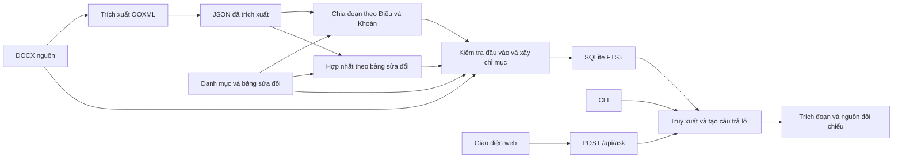

# Kiến trúc và luồng xử lý hiện tại

Hệ thống tra cứu tiếng Việt chạy cục bộ. Nó chuẩn bị trước một chỉ mục SQLite FTS5 từ tài liệu DOCX, sau đó dùng cùng bộ truy xuất cho CLI và giao diện web. Chế độ mặc định trả trích đoạn có nguồn đối chiếu. CLI có thêm tùy chọn tổng hợp bằng Ollama cục bộ.

## Từ DOCX đến dữ liệu truy xuất

| Bước | Xử lý | Đầu ra |
| --- | --- | --- |
| Danh mục | Ghi ID, số hiệu, URL nguồn, đường dẫn DOCX, SHA-256 và metadata văn bản. Bảng quan hệ cấp văn bản ghi phạm vi đã đối chiếu. | [document_registry.json](../registry/document_registry.json), [amendment_mapping.json](../registry/amendment_mapping.json) |
| Trích xuất | Đọc DOCX dưới dạng ZIP và duyệt các khối trong `word/document.xml`. Giữ thứ tự đoạn văn và bảng, ghi nhận chú thích, hình ảnh và vị trí nguồn. Dùng mẫu văn bản để nhận diện Chương, Mục, Điều, Khoản và Điểm. | `data/processed/<id>.json` và `inventory.json`. [Mã trích xuất](../scripts/pipeline/parse_documents.py) |
| Chia đoạn | Nhóm các khối liên tiếp theo Khoản, hoặc Điều nếu chưa nhận diện được Khoản. Khối chưa phân loại vẫn được giữ. Ngữ cảnh cha là metadata. Bước này kiểm tra toàn bộ khối sau khi ghép lại trùng với bản trích xuất, đúng thứ tự. | `data/chunks/<id>.json`. [Mã chia đoạn](../scripts/pipeline/chunk_documents.py) |
| Hợp nhất | Áp dụng bảng đối chiếu vị trí và kiểm tra SHA-256 của DOCX cùng các khối đã trích xuất. Ghép bản 151 đã cập nhật phần liên quan đến 184 với 236, và bản 168 với 238. Kết quả giữ nguồn từng khối, nhật ký thao tác, đoạn thi hành và chuyển tiếp theo phần đã ánh xạ. | Hai bản nháp trong `data/consolidated/`. [Bảng đối chiếu](../registry/consolidation_edits.json), [mã hợp nhất](../scripts/pipeline/consolidate_documents.py) |
| Lập chỉ mục | Kiểm tra SHA-256, độ bao phủ khối và kết quả hợp nhất. Hai văn bản 151 và 168 dùng các khối từ bản ghép. Văn bản còn lại dùng chunk. Mỗi kết quả tìm kiếm tương ứng một khối có nội dung hoặc một hàng bảng kèm tiêu đề. | `data/rag/baseline.sqlite3`. [Mã lập chỉ mục](../scripts/rag/rag_index.py) |

Chỉ mục lưu thông tin văn bản trong `docs`, nội dung và địa chỉ điều khoản trong `evidence`, nội dung đã chuẩn hóa và ngữ cảnh cha trong bảng FTS5 `search`. Bảng `metadata` lưu mã nhận diện tập đầu vào, tính từ phiên bản chỉ mục và băm nội dung các tệp liên quan. Lệnh `build` ghi vào tệp tạm, kiểm tra lại đầu vào rồi thay chỉ mục. CLI và API kiểm tra mã này trước khi trả lời.

## Từ câu hỏi đến câu trả lời

1. Chuẩn hóa chữ thường và dấu tiếng Việt, nhận diện số hiệu văn bản, Điều, Khoản và Điểm khi có. Một số cách nói thông dụng được quy về từ ngữ thường gặp trong văn bản, chẳng hạn “vượt đèn đỏ”.
2. Thu hẹp phạm vi theo văn bản và địa chỉ điều khoản. Nếu câu hỏi không chỉ định văn bản, dùng phạm vi mặc định. Với 236 và 238, phần thi hành và chuyển tiếp theo vùng cấu hình thuộc phạm vi mặc định, còn phần nội dung sửa đổi được truy xuất khi hỏi đích danh văn bản tương ứng.
3. Tra trực tiếp theo địa chỉ khi đủ thông tin, hoặc dùng BM25 trên SQLite FTS5 để tìm ứng viên theo từ và cụm từ. Bộ xếp hạng bổ sung kiểm tra độ phủ từ khóa và các tín hiệu như ngữ cảnh loại xe, cụm từ và hành vi xử phạt.
4. Ghép trích đoạn với tiêu đề cha và các khối con liền sau khi liên kết cha được xác nhận. Mỗi nguồn có nhãn điều khoản, trích đoạn, số hiệu văn bản, URL, SHA-256, tên tệp và vị trí khối. Các phần được sửa còn có thể dẫn đến vị trí chỉ dẫn trong văn bản sửa đổi.

| Chế độ | Khi nào xuất hiện |
| --- | --- |
| `extractive` | Mặc định khi tìm thấy bằng chứng. Câu trả lời lấy trích đoạn phù hợp nhất. |
| `abstain` | Bộ truy xuất không tìm được căn cứ đạt điều kiện. |
| `temporal_review` | Tìm được căn cứ và câu hỏi khớp mẫu thời điểm. Hệ thống đưa bằng chứng để đối chiếu hiệu lực. |
| `ollama` | CLI được cấu hình `--model` và mô hình cục bộ trả câu có chỉ số trích dẫn hợp lệ. Các lỗi kết nối hoặc lỗi đầu ra được xử lý bằng cách quay về trích nguyên văn. |

CLI có ba lệnh `build`, `ask` và `chat`. Mỗi lượt hỏi được truy xuất độc lập. Trình duyệt tải HTML, CSS và JavaScript từ máy chủ cục bộ, gửi câu hỏi dạng JSON tới `POST /api/ask` rồi hiển thị trích đoạn, nguồn có thể mở rộng và liên kết văn bản. Web dùng ba kết quả truy xuất tối đa theo mặc định của hàm trả lời. [CLI và bộ truy xuất](../scripts/rag/baseline_rag.py) · [Máy chủ web](../scripts/rag/web_server.py) · [Mã giao diện](../web/app.js)

## Phạm vi hiện tại

Truy xuất dựa trên từ vựng, địa chỉ và ngữ cảnh văn bản. Phân cấp pháp lý nhận diện theo mẫu còn có thể sai ở trích dẫn sửa đổi, phụ lục hoặc tiêu đề đánh số tự động. Chunk bảo toàn các khối đã trích xuất, trong khi chú thích và hình ảnh ngoài thân văn bản thuộc dữ liệu trích xuất riêng. Bản ghép 151 và 168 bao gồm các sửa đổi có ngày áp dụng riêng. Các trường hiệu lực của từng chunk đang để `unverified`, với cận ngày bắt đầu và kết thúc là `null`.

Kiểm tra chỉ số nguồn trong đầu ra Ollama xác nhận định dạng và phạm vi tham chiếu. Mức độ phù hợp giữa nội dung mô hình sinh và đoạn nguồn cần được đối chiếu trực tiếp.
